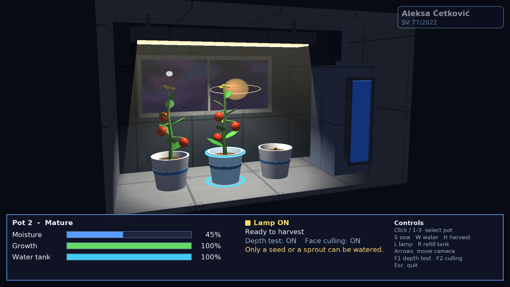

# Space Garden

A small space-station garden rendered with OpenGL 3.3 core (programmable pipeline only):
three pots, a shared lamp and a water tank inside a cabinet. A 2D and a 3D application
share one logic model (`core/`); each app only renders it and maps input to it.

Computer Graphics course project, FTN Novi Sad, 2025/2026 — Aleksa Ćetković, SV 77/2022.



## Requirements (Ubuntu)

```sh
sudo apt install build-essential cmake git libgl1-mesa-dev xorg-dev libwayland-dev libxkbcommon-dev
```

GLFW 3.4, FreeType 2.13 and Assimp 5.4 (OBJ importer only, 3D app) are fetched by CMake on the first configure.
GLAD (GL 3.3 core), GLM 1.0.1, stb_image and the LearnOpenGL `Shader`, `Mesh` and `Model` classes are vendored in `include/`.

## Build and run

```sh
cmake -B build
cmake --build build -j
./build/app2d/space_garden_2d
./build/app3d/space_garden_3d
```

The app opens fullscreen on the primary monitor and runs at 75 FPS. Set `SPACE_GARDEN_WINDOWED=1`
to open a 1280×720 window while debugging. Assets are looked up in `assets/` next to the executable,
then in the source tree (path baked in at configure time), so the binary can be started from any
directory. `SPACE_GARDEN_ASSETS` overrides both.

### Release packages

Prebuilt Linux and Windows builds are attached to the GitHub releases. To build them yourself:

```sh
# Linux (run on the oldest distro you want to support; the binary needs its glibc or newer)
cmake -B build-rel -DCMAKE_BUILD_TYPE=Release -DSPACE_GARDEN_STATIC_RUNTIME=ON
cmake --build build-rel -j
cmake --install build-rel --prefix dist/space-garden-linux-x86_64 --strip

# Windows, cross-compiled with MinGW-w64 (apt install g++-mingw-w64-x86-64-posix)
cmake -B build-win -DCMAKE_TOOLCHAIN_FILE=cmake/mingw-w64-x86_64.cmake \
      -DCMAKE_BUILD_TYPE=Release -DSPACE_GARDEN_STATIC_RUNTIME=ON
cmake --build build-win -j --target space_garden_2d space_garden_3d
cmake --install build-win --prefix dist/space-garden-windows-x86_64 --strip
```

A package is the two executables with `assets/` next to them; the apps look there first.

Logic unit tests and a console version of the garden:

```sh
ctest --test-dir build --output-on-failure   # core logic and 3D ray picking
./build/tests/garden_cli
```

## Controls (2D)

| Input | Action |
|---|---|
| Left click on a pot, or `1` `2` `3` | Select a pot |
| `S` | Sow a seed in the selected empty pot |
| `W` | Water the selected seed or sprout |
| `H` | Harvest the selected mature plant |
| `L` | Turn the lamp on/off |
| `R` | Refill the water tank |
| `Esc` | Quit |

## Controls (3D)

| Input | Action |
|---|---|
| Left click on a pot or plant, or `1` `2` `3` | Select a pot (mouse ray picking) |
| `S` `W` `H` `L` `R` | Sow, water, harvest, lamp on/off, refill tank (as in 2D) |
| `←` `→` | Move the camera along the arc in front of the cabinet |
| `↑` `↓` | Raise / lower the camera (within limits) |
| `F1` | Depth test on/off |
| `F2` | Face culling on/off (with depth test on, the picture does not change) |
| `Esc` | Quit |

The camera always looks at the middle of the garden. The lamp is a spotlight under the cabinet
roof; with the lamp off a weak ambient light keeps the scene visible. The water level is shown
through the window on the tank, and the info panel stays as a fixed 2D layer over the scene.

## How it plays

- Pots start empty, the lamp is off and the tank is full.
- A plant grows only while the lamp is on and its soil is moist; growing uses up moisture.
  When the soil dries out or the lamp is turned off, growth pauses without losing progress.
- Growth goes through three stages: seed → sprout (33%) → mature (100%). Mature plants stop growing
  and drinking and can be harvested, which returns the pot to the empty state.
- Each pour adds a fixed amount of water, limited by the water left in the tank and the pot capacity.
  Droplets fall at a constant speed and disappear when they reach the soil. Watering is blocked
  while the tank is empty.
- Every pot updates independently, whether it is selected or not.

## Project layout

```
core/      garden_core   – pure C++ logic (no OpenGL), unit tested in tests/
engine/    garden_engine – window, frame limiter, textures, sprites, FreeType text, cursor, info panel
app2d/     space_garden_2d – orthographic renderer of the garden
app3d/     space_garden_3d – perspective renderer: orbit camera, procedural meshes, spotlight,
           Assimp plant models, ray picking, transparent tank glass and light beam
assets/    shaders, textures, fonts, cursor images, plant models (OBJ)
tools/     generate_assets.py – draws all textures procedurally (Pillow)
           generate_models.py – builds the three plant stage models (OBJ + MTL)
docs/      proposal, implementation plan, CG notes
```

## Documentation

- `docs/proposal.pdf` — project proposal
- `docs/implementation-plan.md` — step-by-step plan and decisions
- `docs/cg-notes.md` — computer graphics concepts reference

## Credits

- [LearnOpenGL](https://learnopengl.com) by Joey de Vries (CC BY 4.0) — `Shader`, `Mesh` and `Model` classes and techniques.
- [Assimp](https://github.com/assimp/assimp) (BSD 3-Clause) — model loading.
- [DejaVu fonts](https://dejavu-fonts.github.io/) — free license, see `assets/fonts/LICENSE-DejaVu.txt`.
- All textures and cursor images are generated by `tools/generate_assets.py`, the plant models by
  `tools/generate_models.py`.
